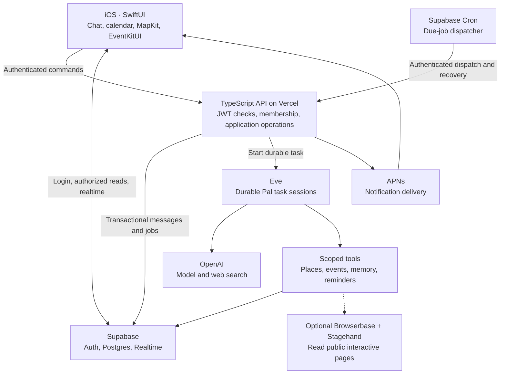

# Pal iOS MVP architecture

Research and design: October 11, 2026. This is a proposed implementation, grounded in current official documentation. No services have been provisioned, API keys used, or runtime compatibility tests performed.

**Decision**

Build a native iOS app in SwiftUI. Use Supabase for authentication, Postgres, realtime updates, and the reminder clock. Deploy a small TypeScript backend with Vercel Eve for durable agent execution. Connect Eve directly to OpenAI using the server's OPENAI_API_KEY. Use MapKit for the map, EventKitUI for user-confirmed additions to the iPhone calendar, and APNs for remote notifications.

Pal is one reusable agent definition that can read a group's permitted conversation, research options, save places, propose plans, and follow up later. Its tools use the same application operations as buttons in the app.

The first product promise: friends share ideas in a group chat; Pal turns them into a confirmed plan and keeps track of the next action.

Assumptions: iOS is the only launch platform; a small hackathon demo is the immediate target; demo participants can sign into real accounts; member positions mean deliberately shared locations. Background location tracking, automatic purchases, and restaurant booking are outside the first version. Cross-platform demand would change the native-client decision.

**System diagram**



This diagram shows proposed responsibilities. Supabase is the product's source of truth; Eve stores execution checkpoints. Realtime tells clients about changes, while Postgres supplies the persisted history.

**Stack and rationale**

| Concern | Choice | Reason and boundary |
| --- | --- | --- |
| iOS interface | SwiftUI, native navigation, SF Symbols | Native typography, gestures, accessibility, keyboard behavior, and map/calendar integration. Target iOS 17+ initially; confirm against the available Xcode/device setup before scaffolding. |
| Auth and shared data | Supabase Auth + Postgres | One identity and database system for group membership, chat, plans, memory, and schedules. |
| Chat updates | Supabase Swift + Realtime Postgres Changes | Small-group MVP needs persisted messages and shared card updates; reconnect also fetches missed records. |
| API and domain operations | TypeScript routes in one Next.js project on Vercel | A small HTTP API for the native client, with Eve embedded via its supported Next.js integration. A web frontend is unnecessary. |
| Agent execution | Eve on Vercel Workflow | Reuse durable execution, tool loops, and run observability. Pin the tested release and its dependency versions. |
| Model | A directly configured OpenAI Responses-compatible model | Your existing API key is sufficient for the provider path. Choose the precise accessible model after a deployed smoke test and short tool-use evaluation; no provider gateway is required. |
| Search and URL reading | Eve's provider-native web_search and web_fetch | Reuse existing tools. Preserve source URLs in results; URL fetching must retain its destination/SSRF checks. |
| Interactive browser | Browserbase + Stagehand, enabled when a demonstrated task requires it | Managed browser sessions are useful for JS-heavy public pages. Requires an additional Browserbase account/key and separate integration validation. Read-only use initially. |
| Reminder clock | One Supabase Cron job, once a minute | Reminders are dynamic database rows. The clock also retries work that was persisted but not dispatched. |
| Notification | Server-side APNs provider using an established library | A phone can be closed when a reminder becomes due. Group messages remain the durable result even if notification delivery fails. |
| Map and place lookup | MapKit + Apple Maps Server API | Native annotations on iOS; backend search/geocoding resolves the places used by agent tools. Server lookup needs an Apple Maps ID and private key. |
| Personal calendar | EventKitUI first; Google Calendar API when server-side coordination is required | User-confirmed event export is small. Per-user Google free/busy and unattended writes require separate OAuth integration. |

Supabase Swift supports Auth, database operations and realtime subscriptions. Table filters improve routing; [RLS policies](https://supabase.com/docs/guides/database/postgres/row-level-security) enforce access. The client receives only the publishable key and its own session. Server credentials never ship in the app. [Swift client](https://github.com/supabase/supabase-swift), [Realtime docs](https://supabase.com/docs/guides/realtime/postgres-changes)

**What Eve gives us, and what Pal still owns**

Eve is a real Vercel framework. Agent instructions, tools, channels and static schedules live in conventional project files. Its sessions run as durable workflows with checkpoints. It can be integrated into a Next.js backend. This fits tasks that should survive a disconnected mobile client or a server process restart. [Vercel introduction](https://vercel.com/blog/introducing-eve), [execution model](https://github.com/vercel/eve/blob/main/docs/concepts/execution-model-and-durability.mdx), [Next.js integration](https://github.com/vercel/eve/blob/main/docs/guides/frontend/nextjs.mdx)

Direct OpenAI access is explicitly supported through eve/models/openai and OPENAI_API_KEY in the server environment. A string gateway model identifier takes a different routing path. We will configure the direct provider explicitly and verify the selected model supports the tools. [Eve model configuration](https://github.com/vercel/eve/blob/main/docs/agent-config.md), [OpenAI tools](https://developers.openai.com/api/docs/guides/tools)

Eve does not supply Pal's group chat, access policies, canonical memory, calendar semantics, maps, APNs setup, or safe business operations. These are application responsibilities. Its checkpoints also do not make an external side effect exactly-once: every write or external action still needs an idempotency policy.

Eve's authored schedules are static at build time. Its documented pattern for user-created schedules is a database-backed schedule store plus an atomic due-job dispatcher. We follow that pattern with Supabase Cron as the clock, rather than authoring a new schedule file for each reminder. [Dynamic scheduling](https://github.com/vercel/eve/blob/main/docs/patterns/dynamic-scheduling.md)

The hosting choice matters: Vercel Hobby Cron currently permits daily execution, while Pro supports minute-level execution. Supabase Cron supports database functions and HTTP invocation at finer intervals, which is why the proposed dispatcher lives there. This does not establish the user's project entitlements or guarantee a free deployment. [Vercel Cron limits](https://vercel.com/docs/cron-jobs/usage-and-pricing), [Supabase Cron](https://supabase.com/docs/guides/cron)

Disable optional Eve default tools, then explicitly enable the required tools. Preserve validated public URL fetching and provider-native search. A broad shell, arbitrary SQL tool, or workspace memory is unnecessary for the demonstrated social-planning tasks. Eve's built-in tools can be selectively enabled. [Built-in tools](https://github.com/vercel/eve/blob/main/docs/concepts/built-in-tools.md)

**Group chat and agent execution**

Every human message is stored once with its author, group, server timestamp and client-generated deduplication ID. In the first version, an explicit @Pal mention, a Share-to-Pal action, a card action, or a previously authorized follow-up starts agent work. Other messages remain available as context. This allows Pal to read the room without paying for an LLM invocation on every casual message.

Use one durable Eve session per task, rather than reusing a single personal assistant session across all members. At task start the backend loads a bounded group snapshot: recent messages, relevant older search hits, saved preferences, open events and pending reminders. Speaker identity is attached to each message. The model's transcript is assembled from persisted records, so a new task still knows the group's relevant history.

The backend fixes the group and requesting user from verified authentication and membership. That context is attached to the task through Eve's authenticated runtime context; tools do not obtain their scope from model-generated group IDs. Scheduled work uses the stored requester and authorization policy and checks current membership again. Eve's native session access stays private to the backend; members observe shared product results through Supabase. Private per-user OAuth credentials remain separate from the group task. [Multi-tenant auth pattern](https://github.com/vercel/eve/blob/main/docs/patterns/multi-tenant-auth.md)

Write the message and any job request in one Postgres transaction. Attempt to dispatch immediately, then let the clock recover queued jobs if that handoff failed. Store Eve's task/session mapping and a stable job identity so an uncertain dispatch can be reconciled before starting another run. Serialize group-mutating tasks using a database lease with renewal and expiry. Reads may proceed independently.

New messages arriving during a task do not silently rewrite its historical snapshot. Before applying a change, the tool checks current event/reminder versions. A changed plan is reloaded or returned for a new confirmation. A task waiting for a person's answer releases the execution lease; the stored proposal remains pending until a new authorized action resumes it.

The UI initially needs a short shared status such as "Pal is finding places" and a final result. Persist status transitions, not every generated token. If a phone reconnects, fetch changes after its last ordered cursor and deduplicate by record ID. Do not rely on a missed realtime event being replayed automatically.

**Agent tools**

| Tool or operation | Result | Rules |
| --- | --- | --- |
| web_search | Answers with supporting sources | Supported direct OpenAI provider; bounded requests/time. |
| web_fetch | Public page content and original URL | Retain redirect and private-network checks; treat retrieved content as untrusted data. |
| browse_page, conditional | Structured details from a public JS page | Isolated managed browser; no personal sessions, submissions, bookings or payments in v1. |
| find_places | Candidates with provider IDs where available, address and coordinates | Use Apple Maps Server API search/geocoding, preserve ambiguity between branches, and let the person choose when needed. MapKit renders the returned locations. |
| save_spot | A shared saved location and source link | Scope and duplicate checking happen in application code; edits use a version check. |
| search_group_context | Relevant permitted messages, preferences, spots and plans | Postgres search plus recent context; indexes include group ID. |
| remember_preference | A group-visible fact with source message reference | Save explicit statements; distinguish a person's preference from a group's decision; members can correct or remove facts. |
| propose_event / confirm_event | A shared calendar record and a card referencing it | Proposal is distinct from confirmation; creator or an authorized member confirms a specific version. |
| create_reminder / update_reminder / cancel_reminder | A persisted schedule with due time and state | A direct request authorizes its reminder; vague timing needs clarification; cancellation invalidates stale claimed work. |
| Google freebusy, later | Time ranges when connected members are unavailable | Each member authorizes their account; group output exposes mutually usable windows, not private event titles. |

The same operations serve the iOS buttons and agent tools. The model supplies validated inputs; the application decides whether an operation is allowed. No special agent-only path should bypass validation or data-loss protections.

Instagram and TikTok links are user inputs, not guaranteed public data feeds. web_fetch and a cloud browser may both hit login walls or missing content. Preserve the link, request a caption/screenshot or place name, then search a place provider. A video-only source is not a dependable first-demo requirement. An optional browser is an escalation path, not an assurance that restricted content can be extracted. [Stagehand](https://docs.stagehand.dev/), [Browserbase](https://docs.browserbase.com/introduction)

**Persistent records**

The schema below is a conceptual contract, not a migration. Additional tables are justified only when an implemented flow needs them.

| Record | Essential contents |
| --- | --- |
| profiles | Auth user ID, display name, avatar, timezone. |
| groups | ID, name, creator, versioned short summary, explicit group-memory facts with source references. |
| group_members | Group/user pair, role, joined time. |
| messages | ID, group, author/type, text, typed card reference, ordered server cursor, client deduplication ID. |
| spots | Group, provider/place ID, display label, permitted cached place data, coordinates, original recommendation URL, saved-by, version. |
| events | Group, title, start/end in UTC, IANA timezone, spot reference, proposal/confirmed/cancelled status, creator, version. |
| reminders | Group, event reference if any, requester, due time, timezone, kind, bounded follow-up instruction or reminder text, version, state, retry/lease information. |
| agent_jobs | Group, requester, trigger message/reminder version, stable dispatch key, Eve session ID, state, lease and concise failure information. |
| location_shares | Group/user pair, coordinate, observed time, accuracy, expiry, sharing state. No location history in v1. |
| devices | User, APNs token, development/production environment, update time and valid/invalid status. |
| calendar_connections, when needed | Private user-owned provider connection and encrypted credential references; per-user external event IDs for confirmed writes. Never subscribe this table to group realtime. |

Index the chat cursor by group, jobs by state/next-attempt, and reminders by state/due time. Database constraints enforce membership references, unique message IDs, reminder delivery identities and valid states. All client-visible tables have RLS; a server credential can bypass RLS, so server operations must still perform explicit access checks.

Memory starts with structured facts and message search in Postgres. Eve compaction helps a task fit into model context; it does not replace editable product memory. Vector databases, embeddings, Redis, and an additional memory vendor add no necessary capability to the first demo.

**Reminders and scheduled agent work**

A reminder stores its exact UTC due time and the originating IANA timezone, plus its creator and target group. Show the interpreted date and time in the chat. Ambiguous dates or missing timezones are resolved before storing a schedule. Start with one-time reminders and one-time follow-ups; recurring schedules add daylight-saving and recurrence semantics and belong to a later iteration.

Once a minute, Supabase Cron calls a protected backend dispatcher. It atomically claims due rows with a lease, checks the row version and current authorization, and processes a bounded batch. Time-only reminders become group messages directly; scheduled research/check-ins become durable agent jobs. A direct reminder does not require the LLM to wake up just to tell the time.

Posting a reminder message and marking that occurrence complete happen in one transaction with a unique delivery identity. A cancelled or revised reminder cannot be posted by an old worker. Failed claims expire and become retryable; retry policies are bounded and leave a visible failure state. Creating a follow-up does not grant permission to make future purchases, share private data or alter an external account.

After the message is committed, the server delivers APNs notifications and records per-device delivery attempts. Failed push attempts retry without recreating the message. Recheck current membership before each push. APNs is not exactly-once or exact-time delivery; network delays and notification permissions apply. Do not promise second-level timing. Minute-level dispatch plus a durable in-app message is the product guarantee target, subject to hosting outages.

The notification payload can contain the group/message ID with a privacy-conscious preview. A tap opens the relevant group and fetches authorized records. APNs needs an Apple developer setup, entitlements, signing and registered device tokens; those are not supplied by an OpenAI key. [Apple remote notification server](https://developer.apple.com/documentation/usernotifications/setting-up-a-remote-notification-server)

**Calendar**

The group calendar is an agenda over the same events shown in chat cards. Edits update that shared record, so chat and calendar cannot drift into two independent plans.

For the smallest working iOS version, "Add to my calendar" opens Apple's event editor with the confirmed title, place, time and alarm. On iOS 17+, Apple supports this user-mediated EventKitUI flow without granting the app full access to all calendar data. The person chooses the destination calendar and saves. A Google calendar configured on the phone may be selected, but this does not establish server-side Google OAuth, read availability, or create automatic two-way synchronization. Repeated exports require an explicit choice, and subsequent group-plan changes tell the person that an exported copy may need updating. [Apple EventKit changes](https://developer.apple.com/documentation/technotes/tn3153-adopting-api-changes-for-eventkit-in-ios-macos-and-watchos)

When Pal must coordinate personal availability while the phone is closed, add per-user Google OAuth in the backend and use Calendar freebusy. Store refresh credentials privately, support reconnect/revocation, and query only connected accounts. An unconnected person supplies time preferences manually; do not invent availability. A server-side create/update/cancel operation has its own confirmed authorization and stored external event ID. [Google freebusy](https://developers.google.com/workspace/calendar/api/v3/reference/freebusy/query)

**Map and member positions**

The map has two filters: Places and People. Places shows the group's stored restaurants/spots; selecting a pin opens the same spot card used in chat, with the original link and a directions action. MapKit is the native rendering layer; Apple Maps Server API search/geocoding is the backend tool. It uses a Maps ID/private key and JWT authorization. Persist the user's saved-spot references and notes, and apply the provider's permitted storage and attribution rules to fetched content. [Apple Maps Server API](https://developer.apple.com/documentation/applemapsserverapi), [place search](https://developer.apple.com/documentation/applemapsserverapi/-v1-search), [server authorization](https://developer.apple.com/documentation/applemapsserverapi/creating-and-using-tokens-with-maps-server-api)

For People, a member taps "Share my location" and grants When In Use authorization. Publish one current location to the selected group with an expiry, for example one hour. A member can explicitly refresh it or stop sharing immediately. Every avatar pin shows when it was observed; expired or revoked shares are excluded by the server's read policy, even before cleanup. Location is hidden from an unselected group and users who leave. The group UI distinguishes unavailable, expired and recently shared positions.

This MVP supplies stored spots and group-member positions. It does not claim continuously live positions when the app is in the background. Continuous live tracking would require separate product consent, background authorization, battery behavior, retention rules and device verification. [Apple location authorization](https://developer.apple.com/documentation/corelocation/requesting-authorization-to-use-location-services), [MapKit content](https://developer.apple.com/documentation/mapkit/mapcontent)

**iMessage-like interaction design**

The app opens to a restrained chat list with group avatars, latest message and unread count. A group opens a familiar conversation with clear sender attribution, dates and an ordinary composer. Keep native text sizing, selection, contrast, VoiceOver labels and reduced-motion support.

The group header opens one group-space screen with Calendar and Map views. Within chat, use three structured cards: Spot, Plan and Reminder. A compact upcoming-plan strip can open the current plan. Cards reference real database records; calendar and map show the same records. Pal's responses are brief and action-oriented. Tool status can say "Checking places" without exposing framework names or implementation details.

An event proposal has Confirm and Edit actions. A reminder shows its scheduled time and a Cancel action. A spot shows its name, locality, source link and map action. Failure states preserve the person's message and offer one useful retry or missing-input action. Human messages, agent replies and system schedule confirmations remain visually distinguishable without relying only on color.

**Minimal API contracts**

| Route group | Responsibility |
| --- | --- |
| Groups and membership | Create a group, issue/redeem an expiring invite, leave a group; every action derives the signed-in user from the JWT. |
| POST group messages | Store the human message and, when triggered, its agent job in one transaction; return canonical IDs even on safe retries. |
| Group actions | Save/edit a spot, confirm/edit an event, create/change/cancel a reminder using the shared operations and expected record version. |
| Location sharing | Set, refresh or revoke the user's selected-group share with server-enforced expiry. |
| Device registration | Associate the current APNs token/environment with the authenticated user. |
| Internal dispatch | Accept only the scheduler's server credential; recover queued jobs and process due reminders. |
| Calendar OAuth, when enabled | Start/callback/disconnect with validated OAuth state and private credential ownership. |

Clients read permitted records with Supabase and subscribe to the selected group's changes. App mutations go through the API or carefully scoped database RPCs. Raw Eve run/session mutation routes are not exposed to group members. Bound input sizes, tool steps, task duration and per-user/group request volume; preserve error states for network, provider and authorization failures.

**Implementation shape**

```text
pal/
  ios/Pal/                 SwiftUI client and native integrations
  backend/
    app/api/               Authenticated application endpoints
    lib/                   Shared domain operations and external clients
    agent/
      agent.ts             Direct OpenAI model, limits, explicit tool selection
      instructions.md      Pal behavior and group interaction rules
      tools/               Search, places, memory, events, reminders
      channels/            Private, authenticated task entry
  supabase/migrations/     Schema, RLS, RPCs and cron setup
```

This is a folder plan only. Add no packages for a web chat UI, no separate queue vendor, no multi-agent coordinator and no custom harness framework.

**Build order and acceptance checks**

1. Prove the infrastructure: a deployed Eve task uses a server-side OpenAI key and scoped tool, survives a closed client, writes a result, and a one-minute stored reminder is dispatched. Pin this working dependency set. If Eve cannot pass this integration promptly, use AI SDK ToolLoopAgent with Vercel Workflow for the same task flow; domain records and native UI remain usable.
2. Ship native group chat with real sign-in, group invitation, authorization, persisted messages and reconnect recovery. Verify two participants see the same history and a non-member cannot fetch it.
3. Connect agent research, place lookup, source-backed spot cards and MapKit. Add explicit, expiring member-location sharing. Verify revoke/expiry/leave-group behavior and handle unavailable social-link content.
4. Connect shared event cards to the agenda, EventKitUI export, reminder CRUD and APNs. Verify a retry creates one message, changing a plan invalidates the old reminder, cancellation wins against a claimed job, and a reminder works with the app closed. Add Google OAuth or interactive browser only if the chosen demo needs them.
5. Rehearse the actual demo on the signed builds: friends share two places, Pal proposes a suitable option, everyone sees a confirmed plan, a calendar export works, the map shows spots/consented positions, and one real follow-up arrives. Measure task completion and manual actions before claiming time saved.

For verification, use a small integration suite around membership isolation, idempotent writes, due-job claiming, cancellation/version races, and expired locations. Use device checks for MapKit, calendar export, notification permissions, navigation and keyboard/accessibility behavior. The architecture document itself has not executed these tests.

Next concrete action: implement the deployed Eve/OpenAI/Supabase reminder spike before building the polished chat screens. This resolves the largest framework and hosting uncertainty early.

Skipped for v1: multi-agent orchestration, vector memory, always-on background tracking, recurring schedules, autonomous booking/payment, full calendar synchronization and app-store release work.
Known risks: Eve/dependency compatibility is untested; social-link access can fail; server place lookup, remote push and calendar OAuth require credentials and entitlements beyond the OpenAI key.
